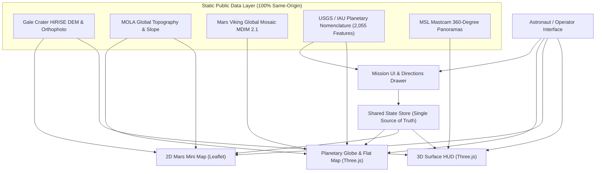

# Martian Map

Spacecraft tablet turn-by-turn EVA surface walk planner and planetary HUD for Martian astronauts and rover navigation, developed for the 2026 NASA Space Apps Challenge.

Live Production URL: https://karthiksreenivasanp.github.io/martian-map/

## Architecture Overview



## Data Sources Summary

Detailed dataset documentation, projections, and citations are available in [DATA_SOURCES.md](DATA_SOURCES.md).

| Name | Mission / Instrument | Upstream URL | License / Rights |
|---|---|---|---|
| Mars Viking Global Mosaic | NASA Viking Orbiters 1 & 2 (MDIM 2.1) | https://astrogeology.usgs.gov | NASA Public Domain (17 U.S.C. 105) |
| MOLA Global Topography | NASA MGS / Mars Orbiter Laser Altimeter | https://pds-geosciences.wustl.edu | NASA Public Domain (17 U.S.C. 105) |
| Gale Crater HiRISE Mosaic | NASA MRO / HiRISE (25 cm/px native) | https://www.uahirise.org | NASA Public Domain (17 U.S.C. 105) |
| Gale Crater Topographic DEM | NASA MRO Stereo DTM / HRSC Blend | https://astrogeology.usgs.gov | NASA Public Domain (17 U.S.C. 105) |
| Planetary Nomenclature | USGS / IAU Working Group (2,055 features) | https://planetarynames.wr.usgs.gov | Public Domain / Open Scientific Data |
| MSL Curiosity 360 Panoramas | NASA MSL Curiosity / Mastcam | https://mars.nasa.gov/msl | NASA Public Domain (17 U.S.C. 105) |

## Local Installation and Execution

Prerequisites: Node.js (version 20 or higher) and npm.

1. Clone repository and install dependencies:
```bash
git clone https://github.com/karthiksreenivasanp/martian-map.git
cd martian-map
npm ci
```

2. Start local development server:
```bash
npm run dev
```
Open `http://localhost:5173/` in a browser.

3. Build production bundle and preview locally:
```bash
npm run build
npm run preview
```
Open `http://localhost:4173/martian-map/` in a browser.

## Security and Compliance Notes

- Static Architecture: Zero backend services, zero database engines, zero accounts or logins, zero runtime user tracking.
- Zero Secret Policy: Zero API keys, private tokens, or credentials are required or embedded. Scanned and verified clean with 0 secret leaks.
- Content Security Policy (CSP): Enforced via meta tag:
  `default-src 'self'; script-src 'self'; style-src 'self' 'unsafe-inline'; img-src 'self' data: blob:; font-src 'self' data:; connect-src 'self'; worker-src 'self' blob:;`
- Referrer Policy: `no-referrer-when-downgrade`
- Rate Limiting and Queueing: In-flight local asset requests are capped at 6 concurrent connections via RequestQueue. Search input events are debounced at 150 ms.
- Dependency Auditing: Scanned with `npm audit` (0 vulnerabilities) and monitored weekly via GitHub Dependabot.

## Verification Log

- Baseline Regression: 6/6 test views verified (Start View, Places Drawer, Route Preview, Layers Card, Weather, Measure) with 0 console errors.
- Production Build: Vite production build succeeded in 235 ms with base path `/martian-map/`.
- Headless Browser Verification: Verified on Chrome at viewports 1280x800, 1024x768, and 768x1024 with 0 console errors and 0 CSP violations.
- Asset Size Compliance: Total dist size 88 MB (well within 1 GB limit), all files below 50 MB GitHub Pages warning threshold.
